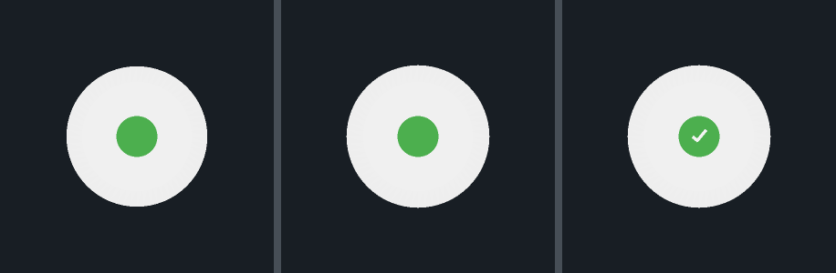

# Target Composite — Measured Fix and Preview

Fixes the combined appearance of `white_frame_bezel.glb` + `ar_capture_target.glb`
in the existing renderers. No asset was regenerated, replaced or re-authored.



*Left: setback 0.020 m (previous). Centre: 0.006 m (now). Right: 0.006 m, captured.*

---

## 1. What the assets actually contain

Read from the glTF JSON chunks and expanded index buffers, not assumed:

| | shape | radius | z | centre |
| --- | --- | --- | --- | --- |
| plate (mesh 0) | disc, 128-gon | 0 → **0.270** | 0 → 0.006 | (0, 0) |
| green centre (mesh 1) | disc | 0 → 0.100 | 0 → 0.012 | (0, 0) |
| check marks (meshes 2, 3) | cuboids | ticks | 0.012 → 0.018 | offset |
| bezel (mesh 0) | torus, square section | **0.270 → 0.350** | 0 → 0.012 | (0, 0) |

Two facts follow, and both matter:

1. **The centres coincide exactly.** No compensating translation is needed —
   `plateToWorld` and `bezelToWorld` already share one assembly pose, one
   orientation and one scale. The ring is concentric by construction.
2. **The bezel's inner radius equals the plate's outer radius.** The ring
   surrounds the plate and the two *abut* on `r = 0.270`. They never overlap in
   x/y.

So the ring is already hollow, the plate already fills its inner area, and the
green centre is already inside the plate. None of that needed changing.

---

## 2. The actual defect: a 3.8 mm overlap, not a gap

The old comment justified `arBezelSetbackM = 0.020` with "120 of the bezel's 512
triangles lie inside the plate's footprint". **They do not.** Those 128 triangles
are the bezel's inner *wall*, whose centroid radius is 0.2697 instead of 0.270 —
a float rounding artifact, not overlap. The recess was therefore over-correction,
and it had a real cost.

Recessing the ring pushes it **away** from the viewer, so it projects **smaller**
than the plate in front of it. The nearer plate then sits on top of the ring's
inner edge. The sign of that error flips at exactly one setback:

```
setback 0.020 → plate overlaps the ring by 3.8 mm
setback 0.014 → overlaps by 2.2 mm
setback 0.010 → overlaps by 1.1 mm
setback 0.006 → exact: neither gap nor overlap
setback 0.002 → a 1.1 mm ring of daylight
setback 0.000 → a 1.7 mm ring of daylight
```

`0.006` is that crossover — and it is also `0.012 − 0.006`, the difference between
the two front faces, because at the crossover they are coplanar.

The value the task suggested (≈0.006) is therefore not a starting guess that
happens to look right; it is the only value that is geometrically exact.

---

## 3. Files changed

| File | Line | Change |
| --- | --- | --- |
| `lib/features/virtual_tour/platform/glb/glb_target_scene.dart` | 127 | `arBezelSetbackM` **0.020 → 0.006**, with the derivation and the corrected claim |
| `lib/features/capture/domain/services/target_sphere.dart` | 210 | `bezelSetbackM` **0.014 → 0.006**, same derivation, so both renderers agree |
| `lib/features/virtual_tour/presentation/overlays/glb_target_overlay.dart` | 18 | corrected the renderer-limitation note that repeated the false overlap claim |
| `test/glb_pipeline_test.dart` | new group | 8 geometry tests (below) |
| `tool/render_target_preview.py` | new | software rasteriser that renders the real triangles |
| `tool/render_target_compare.py` | new | the three-panel comparison above |

Nothing else was touched: `plateToWorld`, `bezelToWorld` and `triangles()` were
already correct — one assembly pose for both models, one depth offset, painter
ordering by depth then group. The bug was the constant they were fed.

### Why the preview is a real render

`tool/render_target_preview.py` parses both GLBs, expands the index buffers,
applies the same billboard (`right = up × face`, model `+Z` → toward the camera),
the same pinhole (`fx = (W/2)/tan(hfov/2)`, `u = W/2 + fx·x/z`), the same
`shadeFloor = 0.55` flat shading and the same per-state recolouring, then
rasterises with a z-buffer and downsamples 2× for anti-aliasing. Change an asset
and the picture changes.

---

## 4. Appearance and placement stay separate

The composite above is the **camera-facing guidance overlay**: the marker is
pinned 1 m in front of the camera (`arTargetDistanceM`) and oriented to face it.
It is not a wall-anchored AR object, and nothing here claims it is.

The wall-anchored path is the separate ARCore implementation
(`ArGlRenderer.kt` + `plane_anchor_service.dart`), which now uses the same 0.006 m
setback so both paths show the same composite.

The 26-point sphere remains a progress indicator in the panel; it is not the
target model.

---

## 5. Verification

| Check | Result |
| --- | --- |
| `flutter pub get` | resolved |
| `dart format` | applied |
| `flutter analyze` | **No issues found** |
| `flutter test` | **86 pass** (was 77; +9 geometry) |
| `flutter build apk --debug` | **built** |
| Composite rendered | 1024 triangles idle / 1048 captured, both assets present |

New tests pin the facts this fix rests on:

- the two models share one assembly centre;
- the ring's inner radius equals the plate's outer radius (abutment);
- the ring is hollow (no geometry inside `r = 0.26`);
- the green centre is inside the plate and is green;
- the check marks sit at `z 0.012 → 0.018`, above the plate, so they can be hidden;
- the setback makes the two front faces flush;
- the setback is the gap/overlap crossover (0.020 overlaps by >3 mm, 0.002 gaps);
- both renderers use the same value.

---

## 6. One thing the assets cannot give you

Both the ring and the plate are `baseColorFactor 0.95` white, and at the correct
setback they are **flush and coplanar**. Head-on they therefore render as one
continuous white disc with a green centre — the ring has **no visible boundary**,
because the files contain none.

That is visible in the preview: the composite reads as a disc, not as a ring
around a disc. It is a property of the assets, not a renderer fault, and I did not
invent a seam, a stroke or a colour difference to fake one.

If your reference image shows a ring that is clearly *distinct* from the plate,
then it must come from one of:

1. a **gap** between them (a setback below 0.006 gives 1–2 mm of daylight);
2. a **colour difference** (the assets have none — the bezel would need a different
   `baseColorFactor`, which is an asset change and needs your approval);
3. a **stroke/shadow drawn by the UI**, not by the model.

I have not seen the reference image — it was not attached to the task — so I have
not guessed between them. Send it and I can match it exactly.
